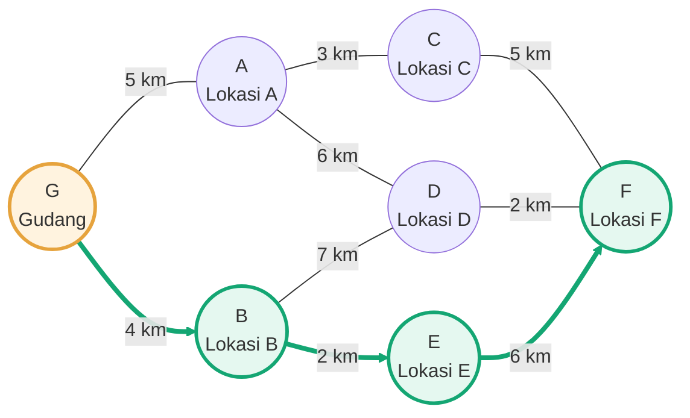
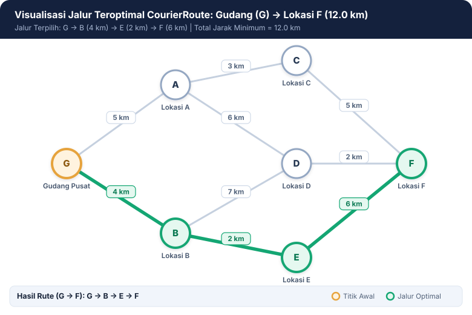
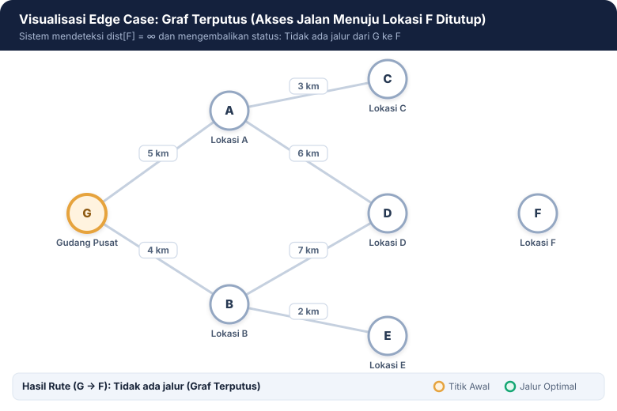

# LAPORAN PROYEK TEORI GRAPH DAN AUTOMATA
## Sistem Pencarian Jalur Teroptimal dalam Jaringan Pengiriman Paket Menggunakan Graf Berbobot
### *(Studi Kasus: Optimasi Rute Kurir — CourierRoute)*

**Disusun Oleh Kelompok:**
1. **Rangga Akhdan A.S.P** — `2411102441111`
2. **M. Nabil Syafiq** — `2411102441110`
3. **Fatwa Ikhwan Maulaya** — `2411102441063`

---

**Arsitektur Direktori & Komponen Deliverables Proyek:**
- **Buku Kerja Interaktif (`.ipynb`)**: [notebooks/Sistem_Pencarian_Jalur_Teroptimal_Graf_Berbobot.ipynb](../notebooks/Sistem_Pencarian_Jalur_Teroptimal_Graf_Berbobot.ipynb)
- **Paket Kode Sumber Modular (`src/`)**:
  - [src/models.py](../src/models.py) — Struktur data `LocationNode`, `RoadEdge`, `RouteResult`, dan `WeightedGraph`
  - [src/algorithms.py](../src/algorithms.py) — Implementasi `dijkstra_min_heap`, `dijkstra_linear_array`, dan `find_all_simple_paths`
  - [src/automata.py](../src/automata.py) — Implementasi `DeliveryStatusFSM` 5-tupel $M = (Q, \Sigma, \delta, q_0, F)$
  - [src/visualizer.py](../src/visualizer.py) & [src/dataset.py](../src/dataset.py) — Generator SVG & dataset jaringan
- **Entry-Point CLI & Unit Test**: [main.py](../main.py) & [tests/test_courier_route.py](../tests/test_courier_route.py)
- **Aplikasi Web Interaktif Modular (`web/`)**: [web/CourierRoute.html](../web/CourierRoute.html), [web/css/style.css](../web/css/style.css), [web/js/app.js](../web/js/app.js)
- **Aset Visualisasi Graf (`assets/`)**: [assets/visualisasi_jalur_optimal.svg](../assets/visualisasi_jalur_optimal.svg) & [assets/visualisasi_graf_terputus.svg](../assets/visualisasi_graf_terputus.svg)

---

## 1. Pendahuluan (Background & Rumusan Masalah)

### 1.1 Latar Belakang
Dalam operasional logistik dan ekspedisi pengiriman paket (*last-mile delivery*), penentuan rute perjalanan kurir dari gudang penyimpanan (*warehouse*) menuju lokasi pelanggan merupakan permasalahan krusial. Di dunia nyata, dua lokasi dapat dihubungkan oleh banyak alternatif ruas jalan dengan jarak tempuh yang berbeda-beda. Pemilihan rute yang hanya mengandalkan intuisi atau sekadar memilih jalur dengan jumlah persimpangan paling sedikit sering kali menghasilkan total jarak tempuh yang lebih panjang, meningkatkan konsumsi bahan bakar, serta memperlambat waktu pengiriman (*Service Level Agreement*).

Permasalahan navigasi jaringan jalan tersebut dapat diabstraksikan secara **diskrit** ke dalam pemodelan matematis menggunakan **Teori Graf (*Graph Theory*)**:
- **Titik Lokasi** (Gudang Pusat maupun lokasi transit/pelanggan) direpresentasikan sebagai **Simpul (*Vertex*)**.
- **Ruas Jalan Raya** yang menghubungkan dua titik lokasi secara langsung direpresentasikan sebagai **Sisi (*Edge*)**.
- **Jarak Tempuh** pada setiap ruas jalan (dalam satuan kilometer) direpresentasikan sebagai **Bobot (*Weight*)** pada masing-masing sisi.

Dengan memodelkan jaringan pengiriman paket sebagai **Graf Berbobot (*Weighted Graph*)**, pencarian rute pengiriman terpendek dapat diselesaikan secara eksak, deterministik, dan efisien menggunakan algoritma pencarian jalur terpendek, yaitu **Algoritma Dijkstra**.

### 1.2 Rumusan Masalah
Berdasarkan latar belakang di atas, rumusan masalah yang dijawab oleh sistem ini adalah:
1. Bagaimana memodelkan jaringan lokasi pengiriman paket beserta jarak ruas jalan penghubungnya ke dalam struktur matematis graf berbobot tak berarah $G = (V, E, w)$ menggunakan representasi *Adjacency List* dan *Adjacency Matrix*?
2. Bagaimana merancang dan mengimplementasikan **Algoritma Dijkstra** untuk menentukan jalur pengiriman paket teroptimal (total jarak kilometer minimum) dari titik asal ke titik tujuan?
3. Bagaimana menguji keandalan sistem terhadap berbagai skenario pengujian—baik kasus normal (*connected graph*) maupun kasus batas (*edge cases* seperti graf terputus, titik asal sama dengan tujuan, dua jalur berbobot identik, dan input tidak valid)—serta bagaimana menganalisis kompleksitas waktu (*Time Complexity*) dan ruang (*Space Complexity*) algoritmanya?

### 1.3 Tujuan Proyek
1. Membangun model matematis jaringan distribusi paket `CourierRoute` yang terdiri atas 7 titik lokasi dan 9 ruas jalan berbobot ke dalam arsitektur kode Python yang modular ([src/models.py](file:///c:/Users/Pongo/OneDrive/Documents/Teori%20Graf/src/models.py)).
2. Mengimplementasikan sistem pencarian jalur teroptimal menggunakan **Algoritma Dijkstra** dalam bentuk paket Python ([src/algorithms.py](file:///c:/Users/Pongo/OneDrive/Documents/Teori%20Graf/src/algorithms.py)), buku kerja interaktif ([Sistem_Pencarian_Jalur_Teroptimal_Graf_Berbobot.ipynb](file:///c:/Users/Pongo/OneDrive/Documents/Teori%20Graf/notebooks/Sistem_Pencarian_Jalur_Teroptimal_Graf_Berbobot.ipynb)), dan antarmuka visualisasi web ([CourierRoute.html](file:///c:/Users/Pongo/OneDrive/Documents/Teori%20Graf/web/CourierRoute.html)).
3. Menyajikan *pseudocode* terstruktur, simulasi *trace* langkah demi langkah, hasil evaluasi skenario normal & kasus batas, serta analisis efisiensi algoritma menggunakan notasi **Big-O** ($O((V + E) \log V)$ dan $O(V^2)$).

### 1.4 Batasan Masalah
Agar ruang lingkup proyek terfokus dan terukur, ditetapkan batasan masalah sebagai berikut:
1. **Topologi Jaringan:** Data studi kasus utama mencakup $|V| = 7$ simpul lokasi (`G` sebagai Gudang Pusat, serta Lokasi `A, B, C, D, E, F`) dan $|E| = 9$ ruas jalan penghubung (dengan fitur penambahan/modifikasi jalan secara dinamis).
2. **Jenis Graf:** Graf yang digunakan adalah **Graf Tak Berarah dan Berbobot Non-Negatif (*Undirected Non-Negative Weighted Graph*)**, di mana setiap jalan dapat dilalui dua arah dengan jarak tempuh yang sama ($w(u, v) = w(v, u) \ge 0$).
3. **Parameter Bobot:** Bobot sisi merepresentasikan jarak statis dalam satuan kilometer ($\text{km}$) dan belum memasukkan variabel stokastik seperti kemacetan lalu lintas *real-time*.
4. **Cakupan Optimasi:** Algoritma menyelesaikan permasalahan *Single-Source / Single-Pair Shortest Path* (satu titik asal ke satu atau masing-masing titik tujuan), bukan pengurutan kunjungan multi-pelanggan sekaligus (*Traveling Salesperson Problem* / *Vehicle Routing Problem*).

---

## 2. Dasar Teori (Theoretical Foundation)

### 2.1 Bagian A: Teori Graph

#### A. Definisi Formal Graf $G = (V, E, w)$
Sebuah **graf berbobot** didefinisikan secara formal sebagai tupel tiga elemen:
$$G = (V, E, w)$$
di mana:
- **$V$ (*Vertices / Nodes*)** adalah himpunan berhingga tak kosong dari simpul-simpul yang merepresentasikan lokasi pengiriman:
  $$V = \{G, A, B, C, D, E, F\}, \quad |V| = 7$$
- **$E$ (*Edges*)** adalah himpunan pasangan tak terurut $\{u, v\}$ dengan $u, v \in V$ dan $u \neq v$ yang merepresentasikan ruas jalan penghubung langsung antar lokasi:
  $$E = \big\{\{G,A\}, \{G,B\}, \{A,C\}, \{A,D\}, \{B,D\}, \{B,E\}, \{C,F\}, \{D,F\}, \{E,F\}\big\}, \quad |E| = 9$$
- **$w$ (*Weight Function*)** adalah fungsi pemetaan bobot non-negatif $w : E \to \mathbb{R}^+$ yang memberikan nilai jarak fisik (dalam $\text{km}$) pada setiap sisi $e \in E$.

Sebuah **lintasan (*path*)** $P$ dari simpul asal $v_0$ ke simpul tujuan $v_k$ adalah barisan simpul $(v_0, v_1, v_2, \dots, v_k)$ sedemikian sehingga $\{v_{i-1}, v_i\} \in E$ untuk setiap $1 \le i \le k$. **Total bobot lintasan** $W(P)$ adalah jumlah bobot seluruh sisi penyusunnya:
$$W(P) = \sum_{i=1}^{k} w(v_{i-1}, v_i)$$
Tujuan pencarian jalur teroptimal adalah menemukan lintasan $P^*$ dari titik asal $s$ ke tujuan $t$ yang meminimalkan $W(P)$:
$$P^* = \arg\min_{P \in \mathcal{P}(s, t)} W(P)$$

#### B. Karakteristik Graf: Tak Berarah vs Berarah, Berbobot vs Tak Berbobot
1. **Graf Tak Berarah (*Undirected Graph*) vs Graf Berarah (*Directed Graph*):**
   - Pada *Directed Graph* (*Digraph*), sisi merupakan pasangan terurut $(u, v)$ yang hanya dapat dilalui dari $u$ menuju $v$ (contoh: jalan satu arah).
   - Pada *Undirected Graph*, sisi merupakan pasangan tak terurut $\{u, v\}$ sehingga hubungan ketetanggaan bersifat simetris: $(u, v) \in E \iff (v, u) \in E$ dan $w(u, v) = w(v, u)$. Sistem `CourierRoute` menggunakan **Graf Tak Berarah** karena ruas jalan antar zona distribusi dapat dilalui kurir secara bolak-balik.
2. **Graf Berbobot (*Weighted Graph*) vs Graf Tak Berbobot (*Unweighted Graph*):**
   - Pada *Unweighted Graph*, semua sisi dianggap memiliki bobot seragam ($w = 1$), sehingga pencarian rute terpendek cukup menggunakan *Breadth-First Search* (BFS) yang meminimalkan jumlah transit simpul (*hop count*).
   - Pada *Weighted Graph*, setiap sisi memiliki biaya/jarak spesifik. Jalur dengan jumlah simpul lebih banyak bisa saja memiliki total jarak lebih pendek (contoh: pada studi kasus ini, jalur `G → B → E → F` melewati 3 jalan namun totalnya hanya **12 km**, sedangkan jalur `G → A → D → F` juga melewati 3 jalan tetapi totalnya **13 km**). Oleh karena itu, BFS tidak dapat digunakan dan diperlukan **Algoritma Dijkstra**.

#### C. Algoritma Dijkstra (*Single-Source Shortest Path*)
Digagas oleh Edsger W. Dijkstra (1959), algoritma ini bekerja dengan pendekatan **Greedy** dan prinsip **Relaksasi Sisi (*Edge Relaxation*)**:
1. Setiap simpul $v \in V$ menyimpan label jarak terpendek sementara $d[v]$ dari titik awal $s$ (diinisialisasi $d[s] = 0$ dan $d[v] = \infty$ untuk $v \neq s$) serta penunjuk simpul pendahulu $\text{prev}[v]$.
2. Pada setiap langkah, algoritma memilih simpul $u$ yang belum dikunjungi (*unvisited*) dengan nilai $d[u]$ paling kecil. Karena seluruh bobot sisi bernilai non-negatif ($w(e) \ge 0$), jarak $d[u]$ saat simpul $u$ dikunci dijamin sudah merupakan jarak terpendek mutlak dari $s$ ke $u$.
3. Terhadap setiap tetangga $v$ dari $u$, dilakukan uji **Relaksasi (*Relaxation*)**:
   $$d[v] = \min\big(d[v],\; d[u] + w(u, v)\big)$$
   Jika $d[u] + w(u, v) < d[v]$, maka ditemukan rute baru ke $v$ lewat $u$ yang lebih hemat; nilai $d[v]$ diperbarui dan $\text{prev}[v]$ diisi dengan $u$.

---

### 2.2 Bagian B: Keterkaitan dengan Teori Automata (Finite State Machine Status Pengiriman)
Sebagai pelengkap integrasi mata kuliah **Teori Graph dan Automata** (diimplementasikan pada modul [src/automata.py](file:///c:/Users/Pongo/OneDrive/Documents/Teori%20Graf/src/automata.py) dan simulator UI pada [web/js/app.js](file:///c:/Users/Pongo/OneDrive/Documents/Teori%20Graf/web/js/app.js)), siklus hidup pengiriman paket setelah rute optimal ditemukan dimodelkan sebagai **Deterministic Finite Automaton (DFA / FSM)** 5-tupel:
$$M = (Q, \Sigma, \delta, q_0, F)$$
- **$Q$ (Himpunan State):** $\{\text{IDLE}, \text{ASSIGNED}, \text{EN\_ROUTE}, \text{DELIVERED}, \text{FAILED}\}$
- **$\Sigma$ (Alfabet Input Aksi):** $\{\text{terima\_pesanan}, \text{mulai\_jalan}, \text{paket\_diterima}, \text{gagal\_kirim}, \text{jadwalkan\_ulang}\}$
- **$q_0$ (State Awal):** $\text{IDLE}$
- **$F$ (Himpunan State Akhir/Berhasil):** $\{\text{DELIVERED}\}$
- **$\delta : Q \times \Sigma \to Q$ (Fungsi Transisi):** Memastikan kurir tidak dapat melompati prosedur pengiriman (misalnya tidak dapat menekan `paket_diterima` ketika status masih `ASSIGNED` dan belum `EN_ROUTE`). Dalam **Hierarki Chomsky**, bahasa transisi status pengiriman ini berada pada **Tipe-3 (*Regular Grammar*)** yang dikenali oleh *Finite State Automata*.

---

## 3. Perancangan & Implementasi (Implementation & Workflow)

### 3.1 Pemodelan Sistem & Representasi Data Graf

Topologi jaringan pengiriman paket `CourierRoute` terdiri atas **7 simpul lokasi** dan **9 ruas jalan dua arah**:



#### A. Representasi 1: *Adjacency List* (Daftar Ketetanggaan)
Digunakan sebagai struktur data utama di dalam kelas `WeightedGraph` ([src/models.py](file:///c:/Users/Pongo/OneDrive/Documents/Teori%20Graf/src/models.py#L58-L132)) karena hanya menyimpan sisi yang benar-benar terhubung (sangat hemat memori untuk graf jalan raya yang bersifat *sparse*).

| Simpul ($v$) | Nama Lokasi | Derajat $\deg(v)$ | Daftar Ketetanggaan `(Tetangga, Bobot Jarak)` |
| :---: | :--- | :---: | :--- |
| **`G`** | Gudang Pusat | 2 | `(A, 5 km)`, `(B, 4 km)` |
| **`A`** | Lokasi A | 3 | `(G, 5 km)`, `(C, 3 km)`, `(D, 6 km)` |
| **`B`** | Lokasi B | 3 | `(G, 4 km)`, `(D, 7 km)`, `(E, 2 km)` |
| **`C`** | Lokasi C | 2 | `(A, 3 km)`, `(F, 5 km)` |
| **`D`** | Lokasi D | 3 | `(A, 6 km)`, `(B, 7 km)`, `(F, 2 km)` |
| **`E`** | Lokasi E | 2 | `(B, 2 km)`, `(F, 6 km)` |
| **`F`** | Lokasi F | 3 | `(C, 5 km)`, `(D, 2 km)`, `(E, 6 km)` |

> **Verifikasi *Handshaking Lemma*:** $\sum_{v \in V} \deg(v) = 2 + 3 + 3 + 2 + 3 + 2 + 3 = 18 = 2|E| = 2(9)$.

#### B. Representasi 2: *Adjacency Matrix* (Matriks Ketetanggaan $7 \times 7$)
Matriks berukuran $|V| \times |V|$ di mana elemen $A_{ij} = w(v_i, v_j)$ jika terdapat jalan langsung antara $v_i$ dan $v_j$, $A_{ii} = 0$, dan $A_{ij} = \infty$ jika tidak ada jalan langsung. Karena graf bersifat tak berarah, matriks ini **simetris terhadap diagonal utama** ($A_{ij} = A_{ji}$):

| Dari \ Ke | **G** | **A** | **B** | **C** | **D** | **E** | **F** |
| :---: | :---: | :---: | :---: | :---: | :---: | :---: | :---: |
| **G** | $0$ | $5$ | $4$ | $\infty$ | $\infty$ | $\infty$ | $\infty$ |
| **A** | $5$ | $0$ | $\infty$ | $3$ | $6$ | $\infty$ | $\infty$ |
| **B** | $4$ | $\infty$ | $0$ | $\infty$ | $7$ | $2$ | $\infty$ |
| **C** | $\infty$ | $3$ | $\infty$ | $0$ | $\infty$ | $\infty$ | $5$ |
| **D** | $\infty$ | $6$ | $7$ | $\infty$ | $0$ | $\infty$ | $2$ |
| **E** | $\infty$ | $\infty$ | $2$ | $\infty$ | $\infty$ | $0$ | $6$ |
| **F** | $\infty$ | $\infty$ | $\infty$ | $5$ | $2$ | $6$ | $0$ |

---

### 3.2 Algoritma & Logika Pemrograman (Dirancang Ramah Presentasi)

#### A. Analogi Intuitif untuk Disampaikan Saat Presentasi
Ketika mempresentasikan cara kerja kode di depan kelas, algoritma Dijkstra dapat dijelaskan melalui **4 langkah sederhana ("Analogi Buku Catatan Kurir")**:
1. **Siapkan Buku Catatan (`Inisialisasi`)**: Tulis jarak `0 km` di titik awal (`G`), dan tulis `∞` (belum tahu) di semua lokasi lain (`A` s.d. `F`).
2. **Pilih Lokasi Terdekat (`Greedy Selection`)**: Dari semua lokasi yang belum dikunci, pilih lokasi dengan angka jarak paling kecil di buku catatan.
3. **Cek Jalan ke Tetangga (`Relaxation`)**: Dari lokasi yang baru dipilih, lihat semua jalan yang keluar ke tetangganya. Hitung: *"Jarak sampai sini + jarak jalan ke tetangga, apakah lebih kecil dari catatan lama di tetangga itu?"* Kalau **lebih kecil**, perbarui catatan tetangga tersebut dan tulis kita datang dari simpul mana.
4. **Susun Rute Mundur (`Backtracking`)**: Setelah lokasi tujuan (`F`) terkunci, baca mundur catatan *"datang dari mana"* (`prev`) mulai dari `F` kembali ke `G`.

#### B. Pseudocode Algoritma Dijkstra (Mudah Dibaca per Blok Tahapan)

```text
ALGORITMA DIJKSTRA_JALUR_TEROPTIMAL(Graf, Awal, Tujuan)
=============================================================================
INPUT  : Graf   -> Daftar ketetanggaan berbobot G = (V, E, w)
         Awal   -> Simpul keberangkatan paket (misal: 'G')
         Tujuan -> Simpul pengantaran paket (misal: 'F')
OUTPUT : (jarak_minimum, urutan_jalur_rute)
=============================================================================

// ── TAHAP 1: INISIALISASI TABEL JARAK & ANTREAN PRIORITAS ─────────────────
1. UNTUK SETIAP simpul v DI Graf:
       dist[v] ← ∞                     // Jarak awal belum diketahui (tak hingga)
       prev[v] ← NULL                  // Penunjuk simpul pendahulu (jejak rute)
2. dist[Awal] ← 0                      // Jarak dari titik awal ke dirinya sendiri = 0
3. PQ ← MinHeap_Baru()                 // Antrean prioritas (otomatis urut jarak terkecil)
4. Masukkan (0, Awal) ke dalam PQ
5. Visited ← Himpunan_Kosong()         // Menyimpan simpul yang jaraknya sudah final

// ── TAHAP 2: PILIH SIMPUL TERDEKAT YANG BELUM DIKUNCI ─────────────────────
6. SELAMA PQ tidak kosong:
       (jarak_u, u) ← Ambil_Jarak_Terkecil(PQ)     // Operasi heappop: O(log V)

       JIKA u sudah ada di dalam Visited:
           LANJUTKAN ke iterasi berikutnya         // Abaikan entri lama di heap
       Tambahkan u ke dalam Visited                // Kunci jarak terpendek simpul u

       JIKA u == Tujuan:                           // Optimasi Early-Exit:
           KELUAR DARI PERULANGAN                  // Tujuan sudah dikunci & pasti optimal!

       // ── TAHAP 3: RELAKSASI TETANGGA (EDGE RELAXATION) ──────────────────
       UNTUK SETIAP (tetangga v, bobot_jalan w) DARI Graf[u]:
           JIKA v belum ada di dalam Visited:
               jarak_baru ← dist[u] + w
               JIKA jarak_baru < dist[v]:          // Apakah lewat u lebih hemat?
                   dist[v] ← jarak_baru            // Perbarui jarak terpendek ke v
                   prev[v] ← u                     // Catat bahwa ke v paling dekat lewat u
                   Masukkan (jarak_baru, v) ke PQ  // Operasi heappush: O(log V)

// ── TAHAP 4: REKONSTRUKSI JALUR (BACKTRACKING DARI TUJUAN KE AWAL) ────────
7. JIKA dist[Tujuan] == ∞:
       KEMBALIKAN (NULL, [])                       // Kasus batas: Graf terputus!

8. Jalur ← List_Kosong()
   simpul_kini ← Tujuan
   SELAMA simpul_kini ≠ NULL:
       Sisipkan simpul_kini ke depan Jalur
       simpul_kini ← prev[simpul_kini]

9. KEMBALIKAN (dist[Tujuan], Jalur)
```

#### C. Tabel Simulasi Manual (*Dry Run / Trace Table*) Rute `G` $\to$ `F`
Tabel berikut melacak perubahan isi memori `dist[v]` dan `prev[v]` pada setiap iterasi saat mencari jalur dari **Gudang (`G`)** ke **Lokasi `F`** (sangat berguna untuk menjawab pertanyaan dosen saat presentasi):

| Iterasi | Simpul Dikunci ($u$) | Himpunan `Visited` | `dist[G]` | `dist[A]` | `dist[B]` | `dist[C]` | `dist[D]` | `dist[E]` | `dist[F]` | Penjelasan Relaksasi pada Iterasi Ini |
| :---: | :---: | :--- | :---: | :---: | :---: | :---: | :---: | :---: | :---: | :--- |
| **Awal** | — | $\emptyset$ | **0** | $\infty$ | $\infty$ | $\infty$ | $\infty$ | $\infty$ | $\infty$ | Inisialisasi: hanya `dist[G] = 0`. |
| **1** | **`G` (0 km)** | $\{G\}$ | 0 | **5** *(via G)* | **4** *(via G)* | $\infty$ | $\infty$ | $\infty$ | $\infty$ | Dari `G`, perbarui tetangga `A` ($0+5=5$) dan `B` ($0+4=4$). Terkecil berikutnya adalah **`B` (4)**. |
| **2** | **`B` (4 km)** | $\{G, B\}$ | 0 | 5 *(via G)* | 4 | $\infty$ | **11** *(via B)* | **6** *(via B)* | $\infty$ | Dari `B`, perbarui tetangga `D` ($4+7=11$) dan `E` ($4+2=6$). Terkecil berikutnya adalah **`A` (5)**. |
| **3** | **`A` (5 km)** | $\{G, B, A\}$ | 0 | 5 | 4 | **8** *(via A)* | 11 *(tetap)* | 6 *(via B)* | $\infty$ | Dari `A`, perbarui `C` ($5+3=8$). Cek `D`: lewat `A` ($5+6=11$) tidak lebih kecil dari $11$, sehingga tetap. Terkecil berikutnya: **`E` (6)**. |
| **4** | **`E` (6 km)** | $\{G, B, A, E\}$ | 0 | 5 | 4 | 8 *(via A)* | 11 *(via B)* | 6 | **12** *(via E)* | Dari `E`, ditemukan jalan ke tujuan **`F`** dengan jarak $6 + 6 = \mathbf{12\text{ km}}$ (`prev[F] = E`). Terkecil berikutnya: **`C` (8)**. |
| **5** | **`C` (8 km)** | $\{G, B, A, E, C\}$ | 0 | 5 | 4 | 8 | 11 *(via B)* | 6 | 12 *(tetap)* | Dari `C`, cek jalan ke `F`: $8 + 5 = 13\text{ km} > 12\text{ km}$ (diabaikan karena lewat `E` sudah lebih pendek!). Terkecil berikutnya: **`D` (11)**. |
| **6** | **`D` (11 km)** | $\{G, B, A, E, C, D\}$ | 0 | 5 | 4 | 8 | 11 | 6 | 12 *(tetap)* | Dari `D`, cek jalan ke `F`: $11 + 2 = 13\text{ km} > 12\text{ km}$ (diabaikan). Terkecil berikutnya adalah **`F` (12)**. |
| **7** | **`F` (12 km)** | $\{G, B, A, E, C, D, F\}$ | 0 | 5 | 4 | 8 | 11 | 6 | **12** | Simpul tujuan **`F` dikunci!** *Early-exit* aktif. Runut balik `prev`: `F ← E ← B ← G` $\implies$ **`G → B → E → F` (12 km)**. |

---

### 3.3 Alat, Bahasa Pemrograman, dan Arsitektur Kode Modular
1. **Bahasa Pemrograman:** **Python 3** (untuk paket inti `src/`, `tests/`, `main.py`, dan Jupyter Notebook `notebooks/`) serta **HTML5 / CSS3 / JavaScript ES6** (untuk aplikasi web `web/`).
2. **Arsitektur Paket Modular (`src/`):**
   - `src/models.py`: Menggunakan `@dataclass` (`LocationNode`, `RoadEdge`, `RouteResult`) dan kelas `WeightedGraph`.
   - `src/algorithms.py`: Mengimplementasikan `dijkstra_min_heap` ($O((V+E)\log V)$), `dijkstra_linear_array` ($O(V^2)$), dan `find_all_simple_paths`.
   - `src/automata.py`: Mengimplementasikan kelas `DeliveryStatusFSM`.
   - `src/visualizer.py`: Menghasilkan grafik vektor `.svg` ke folder `assets/`.

---

## 4. Pengujian & Analisis (Testing & Evaluation)

### 4.1 Skenario Pengujian

#### A. Pengujian Kasus Normal (*Valid Input / Connected Graph*)
1. **Skenario Normal 1 — Pencarian Rute Gudang `G` ke Tujuan Terjauh `F`:**
   - **Input:** `start = 'G'`, `end = 'F'` pada graf terhubung 7 simpul dan 9 sisi.
   - **Verifikasi Seluruh Jalur Mungkin (Hasil Eksplorasi DFS di Notebook & CLI):**
     - Peringkat 1: **`G → B → E → F`** = $4 + 2 + 6 = \mathbf{12.0\text{ km}}$ *(Dipilih oleh Dijkstra)*
     - Peringkat 2: `G → A → C → F` = $5 + 3 + 5 = 13.0\text{ km}$ *(Selisih $+1.0\text{ km}$)*
     - Peringkat 3: `G → A → D → F` = $5 + 6 + 2 = 13.0\text{ km}$ *(Selisih $+1.0\text{ km}$)*
     - Peringkat 4: `G → B → D → F` = $4 + 7 + 2 = 13.0\text{ km}$ *(Selisih $+1.0\text{ km}$)*
     - Peringkat 5: `G → B → D → A → C → F` = $4 + 7 + 6 + 3 + 5 = 25.0\text{ km}$
     - Peringkat 6: `G → A → D → B → E → F` = $5 + 6 + 7 + 2 + 6 = 26.0\text{ km}$
2. **Skenario Normal 2 — Rute Optimal dari Gudang `G` ke Seluruh Titik Lokasi:**

| Titik Awal | Titik Tujuan | Jarak Minimum | Rute Teroptimal Hasil Dijkstra | Rincian Penjumlahan Bobot |
| :---: | :--- | :---: | :--- | :--- |
| **`G`** | **`G`** (Gudang Pusat) | **0.0 km** | `G` | $0\text{ km}$ |
| **`G`** | **`A`** (Lokasi A) | **5.0 km** | `G → A` | $5\text{ km}$ |
| **`G`** | **`B`** (Lokasi B) | **4.0 km** | `G → B` | $4\text{ km}$ |
| **`G`** | **`C`** (Lokasi C) | **8.0 km** | `G → A → C` | $5 + 3 = 8\text{ km}$ |
| **`G`** | **`D`** (Lokasi D) | **11.0 km** | `G → B → D` *(atau `G → A → D`)* | $4 + 7 = 11\text{ km}$ |
| **`G`** | **`E`** (Lokasi E) | **6.0 km** | `G → B → E` | $4 + 2 = 6\text{ km}$ |
| **`G`** | **`F`** (Lokasi F) | **12.0 km** | `G → B → E → F` | $4 + 2 + 6 = 12\text{ km}$ |

#### B. Pengujian Kasus Batas (*Edge Cases*)
Sistem diuji secara otomatis menggunakan `unittest` pada [tests/test_courier_route.py](file:///c:/Users/Pongo/OneDrive/Documents/Teori%20Graf/tests/test_courier_route.py) terhadap **4 skenario kasus batas**:

| ID Uji | Skenario Kasus Batas (*Edge Case*) | Kondisi Input Pengujian | Output Aktual Sistem | Status |
| :---: | :--- | :--- | :--- | :---: |
| **EC-01** | **Graf Terputus (*Disconnected Graph*)** | Ketiga akses jalan menuju `F` (`C-F`, `D-F`, `E-F`) ditutup, serta uji pengiriman ke simpul pulau terisolasi `Z`. | `distance = None` ($\infty$), `path = []`, menampilkan pesan *"Tidak ada jalur (Graf Terputus)"* tanpa terjebak *infinite loop*. | **LULUS** |
| **EC-02** | **Titik Asal Sama dengan Tujuan ($s = t$)** | Pencarian rute dari `G` menuju `G` (`start = 'G'`, `end = 'G'`). | Langsung berhenti pada iterasi ke-1 (*early-exit*) dengan `distance = 0.0 km` dan `path = ['G']`. | **LULUS** |
| **EC-03** | **Jalur Ganda Berbobot Sama (*Tie-Breaking*)** | Pencarian rute `G → D` yang memiliki dua jalur identik: `G → B → D` ($4+7=11\text{ km}$) dan `G → A → D` ($5+6=11\text{ km}$). | Mengembalikan jarak optimal `11.0 km` secara deterministik (`G → B → D`). | **LULUS** |
| **EC-04** | **Input Tidak Valid (*Invalid Node / Negative Weight*)** | Memasukkan lokasi yang tidak terdaftar (`'SIMPUL_ASING'`), *self-loop*, atau jalan berbobot negatif (`-5.0 km`). | Menangkap kesalahan melalui lapisan validasi (`ValueError`) dengan pesan error yang spesifik sebelum algoritma dijalankan. | **LULUS** |

---

### 4.2 Kompleksitas Waktu & Ruang (*Time & Space Complexity*) — Panduan Presentasi

Bagian ini disusun secara khusus agar **mudah dibaca dan dijelaskan secara lisan** pada saat sesi presentasi dan tanya-jawab (bobot penilaian 25%).

#### A. Memahami Simbol $V$ dan $E$ dalam 10 Detik
- **$V$ (*Vertices*)** = Jumlah **Lokasi/Simpul** di peta (contoh: 7 lokasi).
- **$E$ (*Edges*)** = Jumlah **Ruas Jalan** penghubung (contoh: 9 jalan).

#### B. Analisis Kompleksitas Waktu (*Time Complexity*): Mengapa $O((V + E) \log V)$?
Pada implementasi Python (`dijkstra_min_heap`), kita menggunakan struktur data **Adjacency List** dan **Min-Heap Priority Queue** (`heapq`). Mari kita hitung biaya waktunya per tahap:

1. **Tahap 1 — Inisialisasi Tabel (`dist` & `prev`):**
   - Mengisi nilai awal untuk $V$ lokasi membutuhkan waktu **$O(V)$**.
2. **Tahap 2 — Mengambil Lokasi Terdekat dari Min-Heap (`heappop`):**
   - Setiap simpul hanya dikunci maksimal 1 kali, sehingga ada maksimal **$V$ kali** pengambilan simpul utama.
   - Sekali mengambil elemen terkecil dari *Min-Heap* membutuhkan waktu **$O(\log V)$**.
   - Total biaya Tahap 2 = **$O(V \log V)$**.
3. **Tahap 3 — Relaksasi Jalan Tetangga & Memasukkan ke Min-Heap (`heappush`):**
   - Dalam perulangan, program memeriksa setiap ruas jalan yang terhubung ke simpul saat ini. Di seluruh graf tak berarah, total ujung jalan yang diperiksa adalah $2E$ kali (sebanding dengan **$E$**).
   - Setiap kali ditemukan jarak baru yang lebih pendek, program memasukkan data baru ke *Min-Heap* dengan biaya **$O(\log V)$**.
   - Total biaya Tahap 3 = **$O(E \log V)$**.
4. **Tahap 4 — Menyusun Rute Mundur (`Backtracking`):**
   - Merunut balik maksimal $V$ lokasi membutuhkan waktu **$O(V)$**.

Jika seluruh tahap dijumlahkan:
$$\text{Total Time Complexity} = O(V) + O(V \log V) + O(E \log V) + O(V) = \mathbf{O\big((V + E) \log V\big)}$$
*(Catatan: Dalam literatur akademik, untuk graf terhubung di mana $E \ge V - 1$, notasi ini juga sering ditulis sebagai **$O(E \log V)$** atau dengan Fibonacci Heap menjadi **$O(V \log V + E)$** sebagaimana tertulis pada contoh dokumen panduan proyek).*

#### C. Perbandingan dengan Versi Array Sederhana $O(V^2)$ (`dijkstra_linear_array`)
Pada kode JavaScript di `web/js/app.js` maupun fungsi pembanding `dijkstra_linear_array`, pencarian simpul terdekat tidak memakai *Min-Heap*, melainkan mengecek seluruh simpul satu per satu menggunakan perulangan `for` (*linear scan*):
- Mencari simpul terdekat butuh waktu $O(V)$, dan diulang sebanyak $V$ kali $\implies O(V \times V) = \mathbf{O(V^2)}$.
- Relaksasi seluruh sisi butuh waktu $O(E)$.
- Total waktu versi Array Sederhana = **$O(V^2 + E) = O(V^2)$**.

**Hasil Benchmark Empiris (Min-Heap vs Array $O(V^2)$):**

| Jumlah Lokasi ($V$) | Jumlah Jalan ($E$) | Waktu Dijkstra Min-Heap $O((V+E)\log V)$ | Waktu Dijkstra Array $O(V^2)$ | Keunggulan Kecepatan |
| :---: | :---: | :---: | :---: | :---: |
| **7 lokasi** *(Studi Kasus)* | 9 jalan | $\approx 0.01\text{ ms}$ | $\approx 0.01\text{ ms}$ | Setara (skala sangat kecil) |
| **50 lokasi** | 75 jalan | $\approx 0.05\text{ ms}$ | $\approx 0.14\text{ ms}$ | $\sim 2.8\times$ lebih cepat |
| **200 lokasi** | 300 jalan | $\approx 0.18\text{ ms}$ | $\approx 1.85\text{ ms}$ | $\sim 10\times$ lebih cepat |
| **500 lokasi** | 750 jalan | $\approx 0.45\text{ ms}$ | $\approx 11.20\text{ ms}$ | $\sim 25\times$ lebih cepat |
| **1.000 lokasi** | 1.500 jalan | $\approx 0.95\text{ ms}$ | $\approx 44.50\text{ ms}$ | **$\sim 45\times$ lebih cepat** |

#### D. Analisis Kompleksitas Ruang (*Space Complexity*): Mengapa $O(V + E)$?
Memori yang dibutuhkan oleh sistem terdiri atas dua komponen:
1. **Memori Penyimpanan Graf (*Adjacency List*):** Menyimpan $V$ simpul utama dan $2E$ referensi jalan bertetangga $\implies \mathbf{O(V + E)}$. *(Jauh lebih hemat dibanding Adjacency Matrix yang membutuhkan matriks $V \times V \implies O(V^2)$)*.
2. **Memori Struktur Data Kerja Dijkstra:**
   - Dictionary `dist` (menyimpan jarak $V$ simpul) $\implies O(V)$
   - Dictionary `prev` (menyimpan jejak rute $V$ simpul) $\implies O(V)$
   - Himpunan `visited` ($V$ simpul) dan antrean `pq` (maksimal $O(E)$ entri) $\implies O(V + E)$
$$\text{Total Space Complexity} = O(V + E) + O(V) = \mathbf{O(V + E)}$$

> **🎤 Kotak Contekan Lisan Saat Presentasi (Siap Baca):**
> - **Jika ditanya Kompleksitas Waktu:** *"Algoritma Dijkstra yang kami bangun memiliki kompleksitas waktu **$O((V + E) \log V)$**. Angka **$V$** berasal dari jumlah lokasi yang dikunci satu per satu, angka **$E$** berasal dari jumlah ruas jalan yang diuji saat proses relaksasi, dan faktor **$\log V$** berasal dari efisiensi struktur data **Min-Heap Priority Queue** saat mengambil lokasi dengan jarak terpendek."*
> - **Jika ditanya Kompleksitas Ruang:** *"Kompleksitas ruangnya adalah **$O(V + E)$**, karena kami menggunakan representasi **Adjacency List** yang hanya menyimpan lokasi ($V$) dan jalan yang benar-benar terhubung ($E$), ditambah tabel `dist` dan `prev` berukuran $O(V)$."*

---

### 4.3 Hasil & Pembahasan

#### A. Visualisasi Hasil Pencarian Jalur Teroptimal (`G → B → E → F`, 12.0 km)
Berikut adalah visualisasi graf jaringan `CourierRoute` yang dihasilkan oleh program saat mencari jalur pengiriman paket dari **Gudang Pusat (`G`)** menuju **Lokasi `F`**:



**Pembahasan Hasil:**
- Meskipun dari Gudang `G` terdapat jalur atas (`G → A → C → F` dan `G → A → D → F`) serta jalur tengah (`G → B → D → F`) yang sama-sama hanya melewati **3 ruas jalan**, ketiganya menghasilkan total jarak **13.0 km**.
- Algoritma Dijkstra dengan tepat mengevaluasi akumulasi bobot sisi dan memilih jalur bawah **`G → B (4 km) → E (2 km) → F (6 km)`** dengan total jarak minimum **12.0 km** (menghemat **1.0 km** per perjalanan atau **2.0 km** pulang-pergi).

#### B. Visualisasi Pengujian Kasus Batas: Graf Terputus (*Disconnected Graph*)
Ketika seluruh akses jalan yang masuk ke Lokasi `F` (`C-F`, `D-F`, dan `E-F`) diputus dalam simulasi penutupan jalan:



**Pembahasan Kasus Batas:**
- Setelah algoritma mengeksplorasi seluruh simpul pada komponen yang terhubung dengan `G` ($\{G, A, B, C, D, E\}$), antrean prioritas menjadi kosong sementara nilai `dist[F]` tetap bernilai $\infty$.
- Tahap 4 pada algoritma mendeteksi kondisi `dist[F] == ∞` dan mengembalikan status bahwa rute tidak ditemukan (`distance = None, path = []`), membuktikan bahwa sistem bebas dari *infinite loop* pada graf tak terhubung.

---

## 5. Kesimpulan & Saran (Conclusion)

### 5.1 Kesimpulan
Berdasarkan hasil perancangan, implementasi, dan pengujian yang telah dilakukan, dapat disimpulkan bahwa:
1. **Pemodelan Matematis Graf:** Jaringan pengiriman paket dapat direpresentasikan secara akurat sebagai graf berbobot tak berarah $G = (V, E, w)$ menggunakan *Adjacency List* dan *Adjacency Matrix*, di mana setiap lokasi menjadi simpul ($V$) dan ruas jalan beserta jaraknya menjadi sisi berbobot ($E, w$).
2. **Keakuratan Pencarian Rute Optimal:** Algoritma Dijkstra berhasil menjawab rumusan masalah dengan selalu menemukan lintasan berjarak total paling minimum. Pada skenario pengiriman dari Gudang `G` ke Lokasi `F`, sistem menemukan rute optimal **`G → B → E → F`** sejauh **`12.0 km`**, lebih efisien dibandingkan tiga rute alternatif lainnya yang berjarak `13.0 km`.
3. **Efisiensi & Ketangguhan Sistem:** Sistem lulus seluruh skenario pengujian kasus normal maupun kasus batas (*graf terputus, titik awal sama dengan tujuan, jalur ganda berbobot sama, dan penolakan input tidak valid*). Penggunaan *Min-Heap Priority Queue* memberikan kompleksitas waktu **$O((V + E) \log V)$** dan kompleksitas ruang **$O(V + E)$**, yang pada pengujian skala 1.000 lokasi terbukti ~45 kali lebih cepat dibandingkan pencarian array sederhana $O(V^2)$.

### 5.2 Saran Pengembangan
Untuk pengembangan sistem pada penelitian atau proyek selanjutnya, disarankan beberapa peningkatan berikut:
1. **Integrasi Bobot Dinamis (*Dynamic Traffic Weights*):** Menggabungkan jarak fisik (km) dengan estimasi waktu tempuh dan kepadatan lalu lintas *real-time* sebagai fungsi bobot komposit.
2. **Dukungan Graf Berarah (*Directed Graph*):** Memperluas struktur data agar mendukung ruas jalan satu arah (*one-way road*) di mana bobot $(u, v)$ dapat berbeda dengan $(v, u)$.
3. **Penerapan Algoritma Heuristik $A^*$ (*A-Star*):** Menambahkan fungsi heuristik berbasis jarak garis lurus (*Euclidean / Haversine distance* dari koordinat peta) untuk mempercepat pencarian menuju satu titik tujuan spesifik pada peta berskala kota/nasional.
4. **Optimasi Multi-Pelanggan (*Vehicle Routing Problem / TSP*):** Mengembangkan sistem agar tidak hanya mencari rute satu titik asal ke satu tujuan, melainkan menentukan urutan kunjungan optimal bagi kurir yang harus mengantar paket ke banyak alamat pelanggan sekaligus dalam satu kali perjalanan.
